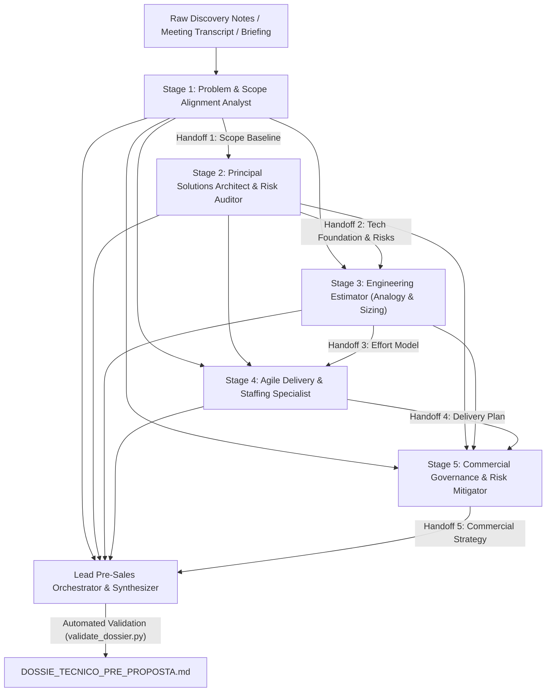

<div align="center">

# Discovery to Proposal Engine Plugin
### Global Multi-Agent Pre-Sales Engineering Pipeline for Google Antigravity

[](https://antigravity.google)
[](#pipeline-architecture-dag)
[](./LICENSE)
[](#critical-negative-constraint-zero-slides-tolerance)

<p align="center">
  <b>Transform unstructured software discovery notes, client interview transcripts, and project briefings into an exhaustive, grounded, analytical technical-commercial pre-proposal dossier (<code>DOSSIE_TECNICO_PRE_PROPOSTA.md</code>).</b>
</p>

</div>

---

## 1. Overview & Core Mission

The **Discovery-to-Proposal Engine Plugin** (`discovery-to-proposal-engine-plugin`) is an enterprise-grade agentic customization for Google Antigravity. It orchestrates a specialized multi-agent engineering team through a Directed Acyclic Graph (DAG) with contextual handoffs to perform end-to-end pre-sales engineering for custom software development engagements.

When a sales engineer or solutions architect inputs messy discovery notes or a meeting transcript, this plugin does **NOT** generate a superficial slide deck or sales pitch. Instead, it systematically interrogates business drivers, audits legacy technical dependencies, sizes effort through calibrated T-shirt analogy, dimensions realistic delivery squads with an uncompromised 75-80% utilization factor, mitigates contractual exposure through tacit acceptance terms, and compiles a comprehensive technical source of truth.

---

## 2. Critical Negative Constraint: Zero-Slides Tolerance

> [!CAUTION]
> **STRICT PROHIBITION OF SLIDES & PRESENTATION FORMATS**  
> This plugin and all constituent agents are **strictly forbidden** from generating PowerPoint/Keynote slides, pitch decks, summary presentation bullets, or abridged outlines (e.g., *"Slide 1: Problem"*, *"Slide 2: Solution"*).  
> The sole authorized primary artifact is a dense, analytical, technical-commercial Markdown dossier titled `DOSSIE_TECNICO_PRE_PROPOSTA.md`.

---

## 3. Pipeline Architecture (DAG)

The pipeline executes as a deterministic 5-stage Directed Acyclic Graph with contextual handoffs:



---

## 4. Specialized Agent Team

| Stage | Agent Persona | Key Focus & Non-Negotiable Output |
| :---: | :--- | :--- |
| **Stage 0** | **Lead Pre-Sales Orchestrator**<br>`stage0-pre-sales-orchestrator-agent` | Root parent agent and master synthesizer. Controls DAG flow, enforces anti-hallucination policies, aggregates partial handoffs, and compiles `DOSSIE_TECNICO_PRE_PROPOSTA.md`. |
| **Stage 1** | **Problem & Scope Alignment Analyst**<br>`stage1-problem-scope-alignment-agent` | Extracts real business pain (5 Whys), establishes quantifiable KPIs/metrics, and builds the ironclad **Delimitation Matrix: Core In-Scope vs. Explicit Out-of-Scope**. Emits `Handoff 1`. |
| **Stage 2** | **Principal Solutions Architect & Risk Auditor**<br>`stage2-solutions-architect-risk-agent` | Audits Technical Red Flags (legacy ERPs, undocumented APIs, LGPD/security NFRs), designs macro architecture topology, and renders a formal verdict on **Phase 0 Technical Inception**. Emits `Handoff 2`. |
| **Stage 3** | **Engineering Estimator (Analogy & Sizing)**<br>`stage3-engineering-estimator-agent` | Decomposes scope into 5 to 8 functional macro-epics, applies T-shirt sizing (S, M, L, XL), computes 3-point PERT ranges, and factors in explicit uncertainty risk buffers (+20% to +40%). Emits `Handoff 3`. |
| **Stage 4** | **Agile Delivery & Staffing Specialist**<br>`stage4-agile-delivery-staffing-agent` | Sizes the engineering squad (Tech Lead, Senior/Mid Devs, QA/SDET, UX, PM) with strict **75-80% effective utilization** (30-32 productive hrs/wk) and structures milestones (M0-M4). Emits `Handoff 4`. |
| **Stage 5** | **Commercial Governance & Risk Mitigator**<br>`stage5-commercial-governance-risk-agent` | Evaluates engagement models (Dedicated Squad, T&M, Fixed Scope), establishes Change Request (CR) thresholds, and drafts client UAT SLAs with a **5-day Tacit Acceptance Clause**. Emits `Handoff 5`. |

---

## 5. Specification of the Final Dossier (`DOSSIE_TECNICO_PRE_PROPOSTA.md`)

The orchestrator compiles a single, exhaustive Markdown dossier structured into 8 mandatory chapters:

1. **Capítulo 1: Resumo Executivo do Problema & Objetivos de Negócio**  
   Organizational context, root operational pains, quantifiable target metrics (KPIs/OKRs), and fundamental business constraints.
2. **Capítulo 2: Matriz de Delimitação: Escopo Contemplado vs. Não-Escopo Explícito**  
   Granular delimitation matrix separating mandatory in-scope items from explicit exclusions, with anti-scope-creep rationale.
3. **Capítulo 3: Relatório de Arquitetura Macro, Integrações Críticas & Red Flags Técnicas**  
   Component topology, modern technology stack, legacy integration audit (ERPs, APIs), Red Flag matrix, and formal **Phase 0 Technical Inception verdict**.
4. **Capítulo 4: Decomposição em Macro-Épicos e Estimativa por Analogia (T-Shirt Sizing)**  
   Decomposition into 5 to 8 macro-epics, T-shirt sizing (S, M, L, XL), three-point PERT effort, and calibrated uncertainty risk buffers (+20% to +40%).
5. **Capítulo 5: Plano de Staffing (Composição da Squad, Senioridade e Carga Horária)**  
   Squad topology (Tech Lead, Devs, QA, UX, PM), seniority mix, and velocity calibration based on **75% to 80% effective utilization**.
6. **Capítulo 6: Cronograma Macro por Marcos de Entrega (Milestones)**  
   Chronological delivery milestones (M0 Inception, M1 Core MVP, M2 Integrations, M3 Hardening/UAT, M4 Go-Live & Hypercare) with concrete exit criteria.
7. **Capítulo 7: Diretrizes de Governança, Homologação e Mitigação de Riscos Contratuais**  
   Change Request (CR) protocol, 5-business-day client UAT window, ironclad **Tacit Acceptance Clause (Cláusula de Aceite Tácito)**, and RACI matrix.
8. **Capítulo 8: Recomendação de Modelo Comercial & Estratégia de Precificação (Memória de Apoio)**  
   Comparative contract model evaluation (Dedicated Squad vs. T&M vs. Fixed Scope), recommended commercial structure, gross project hours, and margin contingency reserve.

---

## 6. Directory Structure

```text
discovery-to-proposal-engine-plugin/
├── plugin.json                                         # Antigravity plugin manifest
├── installed_version.json                              # Version marker (1.0.0)
├── LICENSE                                             # MIT License
├── .gitignore                                          # VCS ignores
├── .gitattributes                                      # Line ending normalization
├── README.md                                           # Comprehensive documentation
├── .claude-plugin/
│   └── plugin.json                                     # Claude Code compatibility manifest
├── assets/
│   └── logo.svg                                        # Official plugin vector logo
├── agents/                                             # Specialized Agent Prompts & Roles
│   ├── stage0_pre_sales_orchestrator_agent.md          # Lead Orchestrator & Synthesizer
│   ├── stage1_problem_scope_alignment_agent.md         # Problem & Scope Alignment Analyst
│   ├── stage2_solutions_architect_risk_agent.md        # Principal Solutions Architect & Auditor
│   ├── stage3_engineering_estimator_agent.md           # Engineering Estimator (T-Shirt Sizing)
│   ├── stage4_agile_delivery_staffing_agent.md         # Agile Delivery & Staffing Specialist
│   └── stage5_commercial_governance_risk_agent.md      # Commercial Governance & Risk Mitigator
├── rules/
│   └── discovery-to-proposal-engine-rules.md           # Guardrails (Anti-Slide, Anti-Hallucination)
├── skills/
│   ├── discovery-proposal-orchestrator/                # Master Orchestration Skill
│   │   ├── SKILL.md
│   │   ├── references/
│   │   │   ├── dag_pipeline_specification.md
│   │   │   └── anti_hallucination_and_risk_policy.md
│   │   ├── resources/
│   │   │   ├── dossier_master_template.md              # Gold-standard dossier template
│   │   │   └── handoff_schemas.json                    # Formal JSON schemas for handoffs
│   │   └── scripts/
│   │       └── validate_dossier.py                     # Automated quality & compliance auditor
│   ├── stage1-problem-scope-alignment/                 # Stage 1 Skill
│   │   ├── SKILL.md
│   │   └── references/scope_delimit_guide.md
│   ├── stage2-tech-architecture-risk/                  # Stage 2 Skill
│   │   ├── SKILL.md
│   │   └── references/architecture_and_red_flags_checklist.md
│   ├── stage3-macro-engineering-estimator/             # Stage 3 Skill
│   │   ├── SKILL.md
│   │   └── references/analogy_tshirt_sizing_models.md
│   ├── stage4-squad-allocation-milestones/             # Stage 4 Skill
│   │   ├── SKILL.md
│   │   └── references/staffing_topology_and_milestones.md
│   └── stage5-commercial-governance-risk/              # Stage 5 Skill
│       ├── SKILL.md
│       └── references/commercial_models_and_governance.md
└── workflows/
    └── discovery_to_proposal_pipeline.json             # Declarative DAG workflow definition
```

---

## 7. Installation & Setup

### Option A: Global Installation in Antigravity (Default)

The plugin resides in the Antigravity global configuration directory:
```bash
~/.gemini/config/plugins/discovery-to-proposal-engine-plugin/
```

To verify discovery by the Antigravity CLI:
```bash
agy plugin list
```
Ensure `discovery-to-proposal-engine-plugin` appears as active and enabled.

### Option B: Project-Level Installation

To vendor the plugin inside a specific client workspace repository:
```bash
mkdir -p .agents/plugins/
cp -r ~/.gemini/config/plugins/discovery-to-proposal-engine-plugin .agents/plugins/
```

---

## 8. Usage & Triggering the Pipeline

Simply invoke Antigravity with your raw discovery notes or meeting transcript:

### Trigger Example 1: Full Pipeline from Raw Notes
```text
Run the discovery-to-proposal pipeline on these client meeting notes to generate DOSSIE_TECNICO_PRE_PROPOSTA.md:

Client: Distribuidora Nacional de Autopeças (150 filial stores)
Problem: Currently orders take 48h to sync between stores and the central TOTVS Protheus ERP.
The store managers use Excel sheets, causing 7% duplicate stock reservations.
They want a web portal where store managers can browse inventory, place emergency stock transfers,
and see delivery status. They also asked for an AI recommendation chatbot and native iPhone app.
Their TOTVS runs on-premise on Microsoft SQL Server with SOAP Web Services, but IT has no test environment.
Target launch is in 4 months.
```

### Trigger Example 2: Ingesting an Interview Transcript
```text
Ingest this discovery transcript and execute the 5-stage pre-sales engineering DAG with contextual handoff.
[Paste Zoom/Teams transcription text here]
```

---

## 9. Automated Dossier Validation

To ensure generated dossiers strictly adhere to all 8 chapters, contain zero forbidden slide patterns, enforce 75-80% utilization, and include tacit acceptance clauses, run the built-in audit script:

```bash
python3 ~/.gemini/config/plugins/discovery-to-proposal-engine-plugin/skills/discovery-proposal-orchestrator/scripts/validate_dossier.py path/to/DOSSIE_TECNICO_PRE_PROPOSTA.md
```

**Verification Output:**
```text
=================================================================
🔍 AUDITING PRE-PROPOSAL TECHNICAL DOSSIER
📄 File: DOSSIE_TECNICO_PRE_PROPOSTA.md
📊 Total Lines: 228 | Total Words: 2421
=================================================================
✅ PASS: Analytical density verified (2421 words).
✅ PASS: Strict Anti-Slide verification passed (0 slide/deck markers found).

--- Auditing 8 Mandatory Chapters ---
✅ Chapter 1: Executive Summary & Problem Statement present.
✅ Chapter 2: Delimitation Matrix: In-Scope vs Explicit Out-of-Scope present.
✅ Chapter 3: Macro Architecture, Critical Integrations & Technical Red Flags present.
✅ Chapter 4: Decomposition into Macro-Epics & Analogy Estimation (T-Shirt Sizing) present.
✅ Chapter 5: Staffing Plan & Squad Topology (75-80% Utilization) present.
✅ Chapter 6: Macro Schedule by Delivery Milestones (M0 - M4) present.
✅ Chapter 7: Governance Guidelines, UAT/Homologation & Tacit Acceptance present.
✅ Chapter 8: Commercial Model Recommendation & Pricing Support Memory present.

--- Auditing Mandatory Technical & Governance Safeguards ---
✅ Concept verified: Delimitation Matrix Table
✅ Concept verified: Technical Red Flags Analysis
✅ Concept verified: Phase 0 (Inception) Formal Verdict
✅ Concept verified: T-Shirt Sizing Application
✅ Concept verified: Utilization Factor (75-80%)
✅ Concept verified: Delivery Milestones (M0 to M4)
✅ Concept verified: Tacit Acceptance Clause (Aceite Tácito)
✅ Concept verified: 5 Business Days Homologation SLA
✅ Concept verified: Change Request (CR) Protocol
✅ Epic Count verified: 6 distinct macro-epics detected.

=================================================================
🎯 FINAL VERDICT: PASS! All pre-sales engineering guardrails verified.
=================================================================
```

---

## 10. Authors & License

Developed with rigorous pre-sales engineering standards by **Halcyon Tech** (`HalcyonTech-LTDA`).  
Distributed under the **MIT License**.
