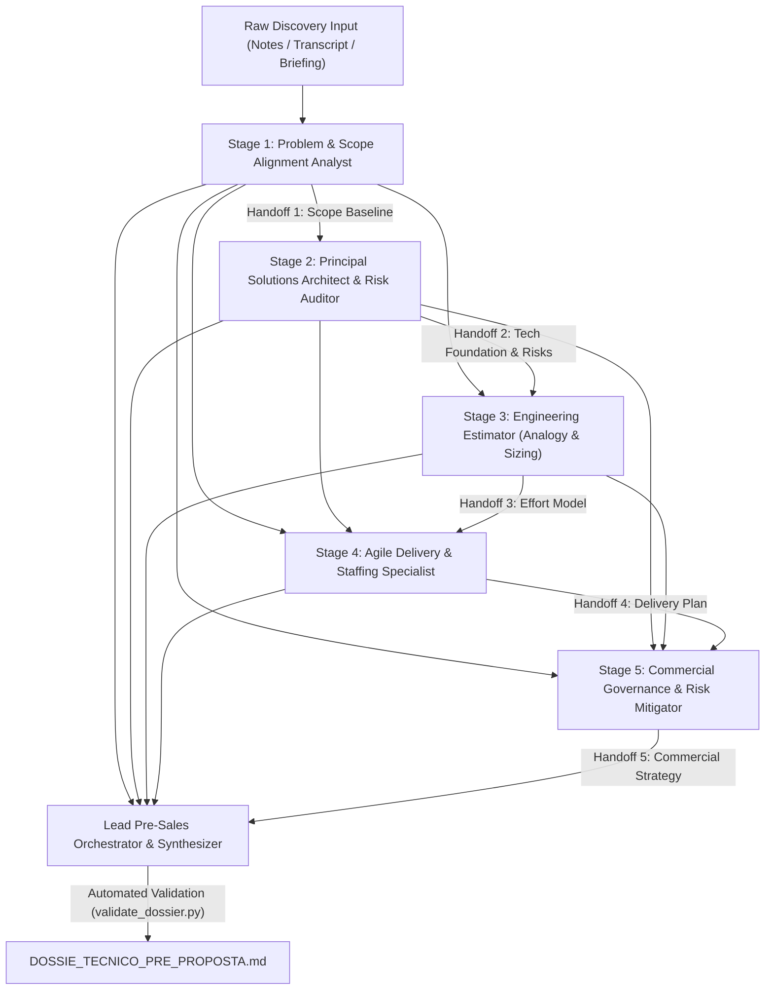

# DAG Pipeline Specification & Contextual Handoff Architecture

## 1. Overview
The **Discovery-to-Proposal Pre-Sales Engineering Engine** organizes complex pre-sales disciplines into an ordered, non-cyclical pipeline (DAG). Each specialist consumes the structured output of upstream nodes and produces a contractually bounded handoff artifact.

---

## 2. Contextual Handoff Contracts

| Handoff Contract | Emitting Agent | Consuming Agent(s) | Primary Information Transferred |
| :--- | :--- | :--- | :--- |
| **Handoff 1: Scope Baseline** | Stage 1 Analyst | Stage 2, 3, 4, 5, Orchestrator | Core business pains, measurable KPIs, Delimitation Matrix (In-Scope vs. Explicit Out-of-Scope), business assumptions. |
| **Handoff 2: Tech Foundation & Risks** | Stage 2 Architect | Stage 3, 4, 5, Orchestrator | Macro topology, technology stack, legacy integration red flags, security/LGPD NFRs, Phase 0 Inception verdict. |
| **Handoff 3: Effort Model** | Stage 3 Estimator | Stage 4, 5, Orchestrator | 5-8 macro-epics, T-shirt sizing (S/M/L/XL), 3-point PERT effort, explicit uncertainty risk buffers (+20% to +40%). |
| **Handoff 4: Delivery Plan** | Stage 4 Staffing | Stage 5, Orchestrator | Squad topology (seniority & roles), 75-80% utilization calibration, calendar duration, Milestones M0-M4 with exit criteria. |
| **Handoff 5: Commercial Strategy** | Stage 5 Governance| Orchestrator | Contract model fit, Change Request (CR) governance, client UAT SLAs with 5-day Tacit Acceptance, pricing memory. |

---

## 3. Data Integrity & Invariance Rules

1. **Downstream Immutability**: Downstream agents cannot modify an upstream decision without registering an explicit architectural override with justification.
2. **Deterministic Fallback**: In execution environments where parallel or dynamic subagent invocation is restricted, the root agent executes the stages synchronously in serial DAG order.
