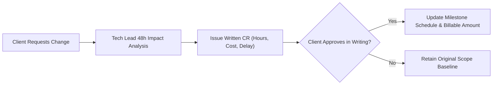

# Commercial Models, Governance & Contractual Risk Mitigation

## 1. Commercial Engagement Models Comparison

| Model | Mechanics | When to Choose | Client Risk | Agency Risk | Recommendation |
| :--- | :--- | :--- | :--- | :--- | :--- |
| **Dedicated Agile Squad** | Monthly retainer for dedicated cross-functional engineering team. | Evolving requirements, long-term roadmap, modern SaaS. | Low (full velocity visibility) | Low (stable, guaranteed margin) | **HIGHLY RECOMMENDED** |
| **Time & Materials (T&M) with Cap** | Billed by actual hours worked up to contract cap. | Well-defined modules with minor legacy unknowns. | Moderate | Low | **VIABLE ALTERNATIVE** |
| **Fixed Scope / Turnkey** | Lump-sum fixed price for rigid milestone specification. | Strictly commoditized software with 100% frozen specs. | Perceived Low (reality: adversarial) | **EXTREME (Catastrophic)** | **REJECTED** (Unless +40% buffer added) |
| **Staged 2-Contract (Inception + Build)** | Contract 1: Paid Inception. Contract 2: Dedicated Squad Build. | Any project with legacy ERPs, unknown APIs, or high uncertainty. | Minimal (limits upfront capital risk) | Minimal (eliminates unpriced risk) | **MANDATORY GATEWAY** |

---

## 2. Standard Legal Clause: Tacit Acceptance (Aceite Tácito)

*(Contractual clause template for client proposals and master services agreements)*

> **CLÁUSULA DE HOMOLOGAÇÃO E ACEITE TÁCITO:**  
> A CONTRATADA notificará a CONTRATANTE por escrito assim que qualquer entrega de Marco/Milestone for disponibilizada no ambiente de homologação (Staging).  
> 
> 1. A CONTRATANTE terá o prazo improrrogável de **5 (cinco) dias úteis** contados da data de notificação para realizar os testes de aceitação e apresentar formalmente eventuais inconsistências encontradas.  
> 2. Somente serão consideradas impeditivas para o aceite falhas classificadas como **Severidade 1 (Crítica/Bloqueante)**, caracterizadas por travamentos completos do sistema, corrupção irreparável de dados ou indisponibilidade total do fluxo principal de negócio sem solução de contorno (*workaround*). Falhas de menor severidade (Severidades 2 e 3) não impedirão o aceite formal e serão priorizadas no backlog das sprints seguintes.  
> 3. Caso a CONTRATANTE não se manifeste expressamente por escrito no prazo estipulado de 5 (cinco) dias úteis, ou inicie o uso produtivo da solução antes do término desse prazo, **a entrega correspondente será considerada tacitamente, integralmente e irrevogavelmente aceita e homologada para todos os fins de direito e faturamento**, autorizando a emissão da respectiva nota fiscal e o prosseguimento regular das fases subsequentes do projeto.

---

## 3. Change Request (CR) Protocol Mechanics

